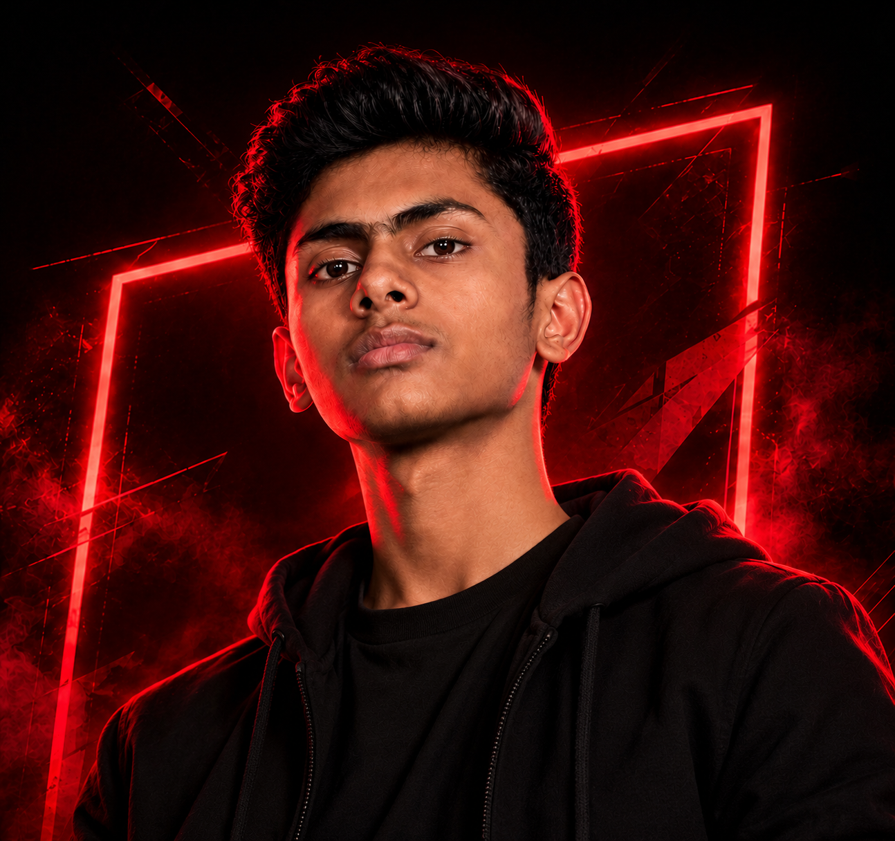

 

<!-- ANUJ GUPTA | BLACK & CRIMSON PORTFOLIO THEME -->

 

---

##  About Me

### Hello, I'm Anuj Gupta 👋

I'm a **B.Sc. IT student and frontend developer** passionate about creating modern websites, exploring software development, and experimenting with AI-powered ideas.

I enjoy transforming creative concepts into responsive, interactive, and meaningful digital experiences.

- 🎓 Currently pursuing SYBSc IT.
- 💻 Exploring frontend and software development.
- 🌐 Building responsive web applications.
- 🤖 Interested in AI-powered solutions.
- 🎨 Passionate about UI design and graphic designing.
- 🚀 Working towards becoming a Software Engineer.

 

| 16+ | Project-Driven | Open to | Continuous |
|:---:|:---:|:---:|:---:|
| Public Repositories | Learning | Collaboration | Growth |

---

##  Skills & Technologies

### 🌐 Frontend Development

### 💻 Programming Languages

### 🗄️ Database & Development Tools

### 🎨 Other Skills

---

##  Things I've Built

### 🚀 Turning ideas into digital experiences

<table>
<tr>
<td width="50%" valign="top">

### 💸 ExpenseTracker

Personal finance management application for tracking expenses and understanding spending habits.

  

</td>
<td width="50%" valign="top">

### 📁 DocuServe

Smart document services platform focused on PDF conversion, document processing, and spreadsheet analysis.

  

</td>
</tr>

<tr>
<td width="50%" valign="top">

### 🤖 SoulTalk AI

AI companion application exploring intelligent conversations, voice interaction, and emotional awareness.

  

</td>
<td width="50%" valign="top">

### 🧠 CodeQuiz

Interactive programming quiz platform with 700+ questions across 8 programming languages, scoring, progress tracking, and bookmarks.

  

</td>
</tr>

<tr>
<td width="50%" valign="top">

### 🎮 Retro Games Collection

A collection of browser-based games featuring classic arcade-style entertainment and interactive gameplay.

  

</td>
<td width="50%" valign="top">

### 💖 Ehsaas

A soulful Shayari platform featuring Love, Sad, Motivation, and Life categories.

  

</td>
</tr>

<tr>
<td width="50%" valign="top">

### 🦸 Marvel Studios

An immersive Marvel-themed website celebrating superheroes and cinematic experiences.

  

</td>
<td width="50%" valign="top">

### 📄 ResumePro Builder

Resume creation application designed to help users build and export professional resumes.

  

</td>
</tr>
</table>

---

##  Education

| Qualification | Performance |
|:---|:---:|
| SSC (10th) | 77% |
| HSC (12th) | 83.67% |
| FYBSc IT – Semester 1 | 8.89 SGPA |
| FYBSc IT – Semester 2 | 8.73 SGPA |
| SYBSc IT | Currently Pursuing |

---

##  GitHub Statistics

  

  

---

##  Let's Connect

### Have an idea? Let's build something amazing.

I'm always interested in learning, collaborating, and exploring new opportunities.

 

---

### CODE. CREATE. LEARN. GROW.

*Building digital experiences that feel different.*

